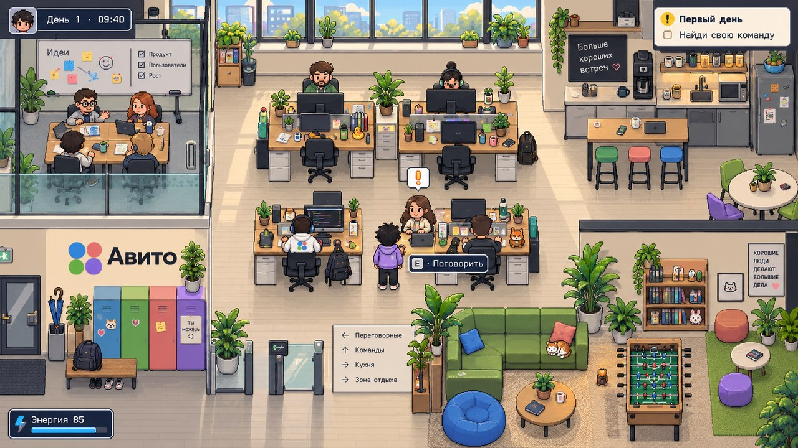
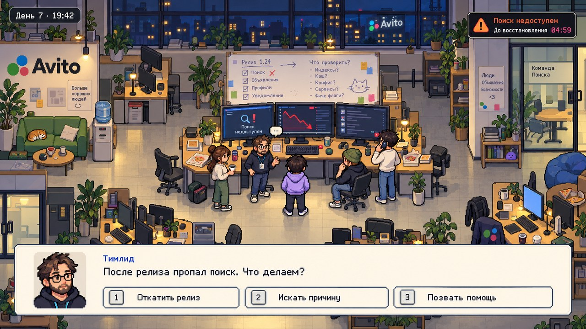
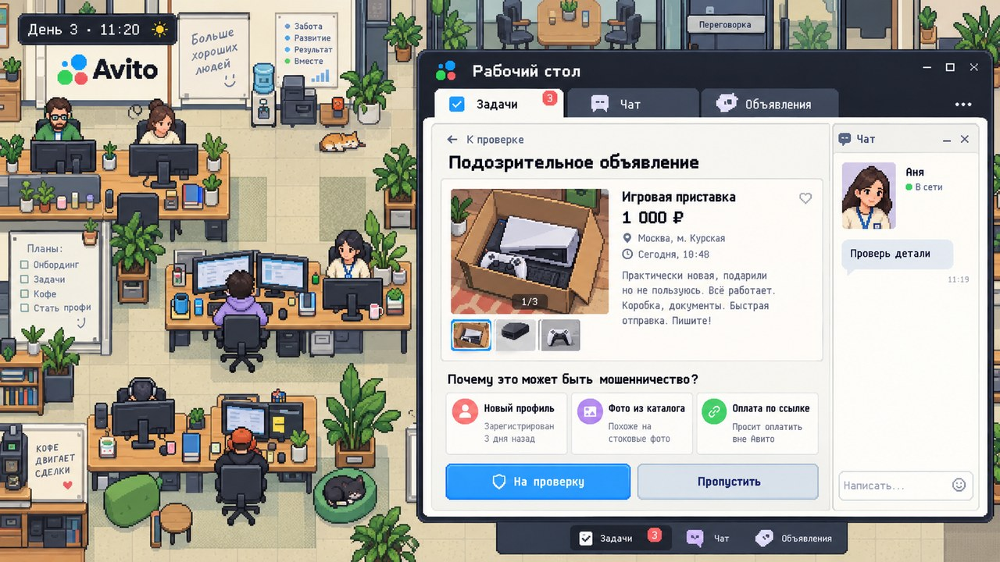

# Авито: испытательный срок

**A cozy pixel-art office adventure about finding your place on a product team.**

Arrive as an intern, explore a lively office, solve small marketplace mysteries, get to know colleagues and see how your decisions shape the next working day.

> **Status: concept and production preparation.** This repository currently contains original visual references, the game design, campaign planning data and art-integration specifications. There is no playable build yet. Runtime art and animation production is the next milestone.

*Visual concept, not a screenshot of a playable build.*

## The planned experience

- A top-down office with workstations, meeting rooms, a kitchenette and places to unwind.
- Twelve fictional colleagues with routines, personal stories and memories of your choices.
- Thirty authored working days, from a first badge to the final internship conversation.
- Short puzzles about listings, search, quality, research, accessibility and incident response.
- Decisions with later consequences, multiple endings and an optional personalized desk.
- Russian gameplay text, readable interfaces and adjustable time pressure.

The current planning catalog contains120 distinct event premises and 360 choice labels. These are writing seeds, not120 implemented quests. Target playtime will be measured after a playable campaign exists.

## More visual concepts

## Planned controls

| Action | Default |
|---|---|
| Move | WASD / arrow keys |
| Interact / confirm | E / Enter |
| Pause / back | Escape |
| Workstation and dialogue | Mouse or keyboard |

Desktop browser is the first target. Touch support is planned separately.

## Development

Engine baseline: Phaser 3.90.0 + TypeScript + Vite. Dependencies, runtime code and verified start/build commands will be added with the first playable slice. Until then, do not expect `npm run dev` to exist.

Read the [game design](docs/GAME_DESIGN.md), [campaign catalog](docs/EVENT_CATALOG.md), [art direction](docs/ART_DIRECTION.md), [asset contract](docs/ASSET_CONTRACT.md), [architecture](docs/TECHNICAL_ARCHITECTURE.md) and [production roadmap](docs/PRODUCTION_PLAN.md).

The first playable milestone is three complete working days. The full campaign follows after its movement, art, interactions, saving and consequences have been tested together.

## Project identity and credits

An unofficial fictional fan project. It is not affiliated with or endorsed by Avito, and the office, characters and procedures are invented. Brand names belong to their respective owners. No real listings, private company systems or real user data are required.

Concept imagery was created with AI image generation and is provided as an art-direction reference, not a ready-to-use runtime asset pack. Asset-specific provenance and third-party font/audio licenses will be recorded as production assets are added. No blanket open-source license has been selected for this repository yet.
